# Batch Transfer quick start

Batch Transfer moves data between XNAT projects in one batch. It can **share** subjects and sessions with another
project, **clone** them into an independent copy, or **reimport** image sessions so that they are anonymized on the
way in. This guide uses an example study to walk through each operation, then shows how to follow, stop and rerun a
transfer in History.

The screenshots come from XNAT 1.10.2.1 with Batch Transfer 2.0.0. All the data in them is synthetic.

## Contents

1. [The example study](#1-the-example-study)
2. [Open Batch Transfer](#2-open-batch-transfer)
3. [A tour of the screen](#3-a-tour-of-the-screen)
4. [Share subjects with another project](#4-share-subjects-with-another-project)
5. [Clone subjects into a working project](#5-clone-subjects-into-a-working-project)
6. [Reimport sessions with anonymization](#6-reimport-sessions-with-anonymization)
7. [Follow a transfer in History](#7-follow-a-transfer-in-history)
8. [Stop a transfer and rerun what's left](#8-stop-a-transfer-and-rerun-whats-left)
9. [History without a project](#9-history-without-a-project)
10. [Good to know](#10-good-to-know)

## 1. The example study

The Healthy Aging Imaging Study keeps its data in **HA_MRI**. Each of its 20 subjects, `HA0001` to `HA0020`, has
three image sessions: a baseline MR (`_MR01`), a PET (`_PT02`) and a follow-up MR (`_MR03`). Six MR sessions also
have a QC assessment. The study team moves data out of HA_MRI to three other projects:

| Project | Running title | Used for | Operation |
|---|---|---|---|
| `HA_CONSORTIUM` | Aging Consortium | Data the study shares with a multi-site consortium | Share |
| `HA_ANALYSIS` | HA Analysis | Working copies that analysts can edit | Clone |
| `HA_OPEN` | HA Open Data | A public release, with new IDs and no patient identifiers | Reimport |

HA_OPEN has a project anonymization script that removes the birth date, sets the institution name and marks the
patient identity as removed.

The screenshots were taken by `jlee`, an owner of all four projects.

## 2. Open Batch Transfer

**From a project.** Open the source project and choose **Batch Transfer** in its **Actions** box. The item appears
for project owners, members who can edit the project's data, and site administrators.

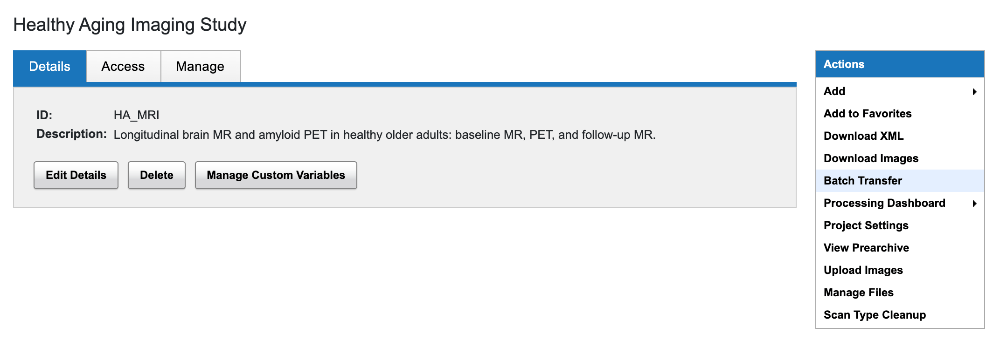

**From a listing or search results.** In any data listing, open **Options** and choose **Batch Transfer**. The screen
opens with the items in that listing. If they come from more than one project, you can only select items in the tree,
because a manifest needs a single source project.

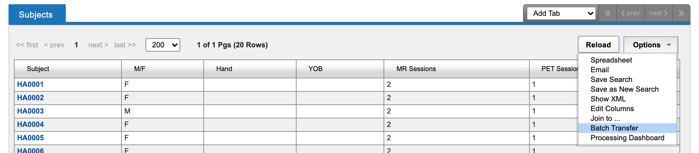

**To look at past transfers only**, use **Tools > Batch Transfer History** (see
[History without a project](#9-history-without-a-project)).

## 3. A tour of the screen

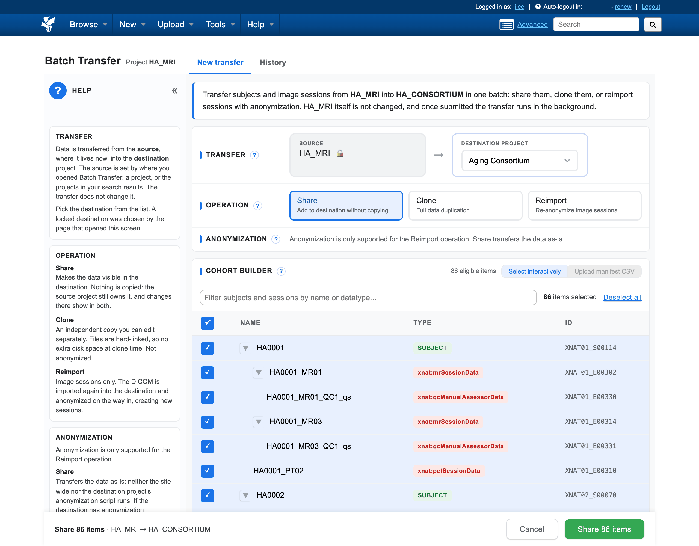

The screen has two tabs: **New transfer**, where you set up a transfer, and **History**, which lists past and
running transfers. New transfer has these parts, from top to bottom:

- **Help** (left): a short topic for each part of the screen. Click **«** to hide the column and **»** to show it
  again; Batch Transfer remembers your choice. The **?** next to each heading scrolls the column to its topic.
- **Summary**: one sentence saying what will happen, naming the source and destination.
- **Transfer**: the source, which is fixed by where you opened the screen, and the **Destination project** list,
  which shows each project's running title.
- **Operation**: Share, Clone or Reimport.
- **Anonymization**: Reimport's anonymization options. For Share and Clone, this row only says that they don't
  anonymize.
- **Cohort builder**: the data to transfer. **Select interactively** shows a tree of subjects, sessions and
  assessors. Every item is selected when the screen opens. **Upload manifest CSV** (Reimport only) takes the list
  of sessions from a file instead.
- **Action bar** (bottom, always visible): what will be transferred, the status chips, and the **Submit** button,
  which names the operation and the count, for example **Share 8 items**.

The chips in the action bar summarize anonymization and storage. Hover over a chip for a full explanation.

| Chip colour | Meaning |
|---|---|
| Green | Anonymization will run, or the transfer uses no extra storage |
| Amber | The transfer duplicates files and uses more storage |
| Red | Check this: anonymization will be skipped, or more than one script will change the data |
| Grey | Batch Transfer couldn't tell, for example because it couldn't check the destination's settings |

If something blocks the transfer, the action bar says what (for example "Blocked: select a destination") and
**Submit** is disabled.

## 4. Share subjects with another project

Share makes data visible in another project without copying it. HA_MRI still owns the data, and any change to it
shows in both projects. Nothing is anonymized.

To share subjects `HA0002` and `HA0004` with the consortium:

1. In **Destination project**, choose **Aging Consortium** (`HA_CONSORTIUM`).
2. Leave **Operation** on **Share**.
3. Click **Deselect all**, then tick `HA0002` and `HA0004`. Ticking a subject ticks its sessions and assessors.
   Click the arrow beside a subject to collapse or expand it, or type in the filter box to find items by name or
   data type.
4. Click **Share 8 items**.

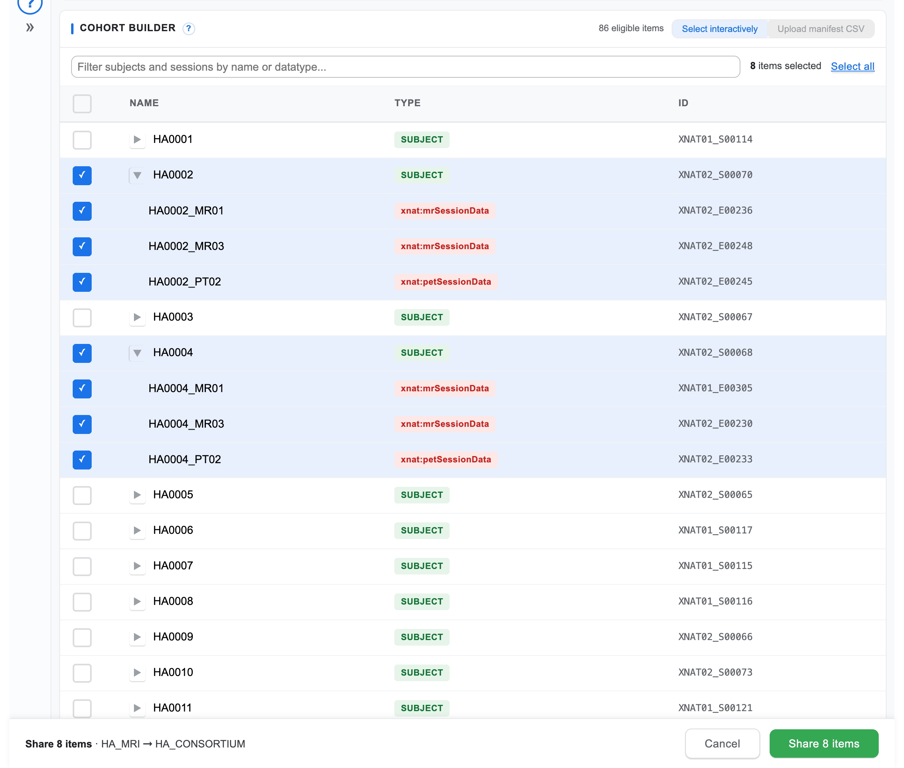

A confirmation dialog shows the cohort ("2 subjects and 6 sessions"), the operation, and that Share copies data
as-is. Click **OK** to start. The screen switches to History, with the new transfer at the top of the list.

To remove shared data from HA_CONSORTIUM later, unshare it there. Don't delete it: the data still belongs to
HA_MRI.

## 5. Clone subjects into a working project

Clone makes an independent copy in the destination, which can be edited without changing the source. Batch
Transfer hard-links the files, so the copy takes no extra disk space when it's made. Clone doesn't anonymize. If the
destination has anonymization enabled, the Anonymization row warns you that its script won't run.

To give the analysts copies of `HA0007` and `HA0008`, including their QC assessments:

1. In **Destination project**, choose **HA Analysis** (`HA_ANALYSIS`).
2. Choose **Clone**.
3. Click **Deselect all**, tick `HA0007` and `HA0008`, and click **Clone 12 items**.

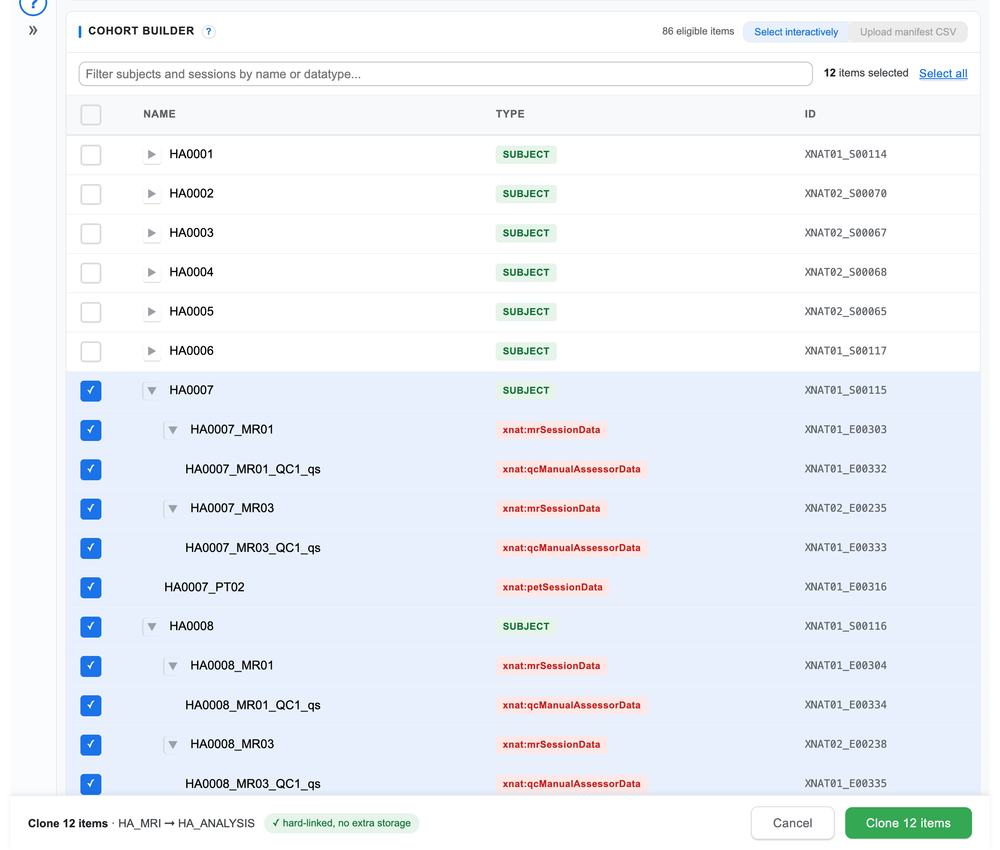

The 12 items are 2 subjects, 6 sessions and 4 QC assessments. The green **hard-linked, no extra storage** chip
confirms the storage cost.

## 6. Reimport sessions with anonymization

Reimport imports each session's DICOM again into the destination project. It creates new sessions there, and the
anonymization scripts run on the way in. Use it when data must leave the source project de-identified. Reimport
handles image sessions only: subjects and assessors aren't listed in the tree.

In this example the study releases its first seven MR sessions, from four subjects, to HA_OPEN. Each subject gets a
release ID such as `HAOPEN001`, which replaces the patient's name and ID.

### Scripts that run

Up to three DicomEdit scripts can run on a reimported session, in this order:

1. The **site-wide** script, if your administrator enabled one, as each file arrives.
2. Your **custom** script, if you add one, straight after.
3. The **destination project's** script, if enabled, when the session is archived. It runs last, so it wins when
   two scripts set the same tag.

If no script is enabled and you don't add one, the sessions are not anonymized, and a red chip says so.

### Set up the transfer

1. In **Destination project**, choose **HA Open Data** (`HA_OPEN`), and choose **Reimport**.
2. In **Anonymize with**, choose **Add custom script**. (**Destination only** runs just the site-wide and
   destination scripts.)
3. Paste the script, or click **Upload file** and choose [`open_release.das`](quick-start/open_release.das):

   ```
   version "6.1"
   // Healthy Aging open data release: the release ID from the manifest replaces the patient's name and ID.
   (0010,0010) := "${csv.destination_subject_label}"
   (0010,0020) := "${csv.destination_subject_label}"
   (0010,4000) := "Healthy Aging open data release ${csv.release}"
   -(0008,0090)
   -(0010,1000)
   ```

   `${csv.<column>}` takes each session's value from the manifest column of that name. A file you load replaces the
   editor's contents; **Undo** brings them back.
4. Click **Validate**. Batch Transfer checks the DicomEdit syntax, the version, commands that aren't allowed, and
   that every placeholder has a manifest column. Submit stays disabled while the script has errors.

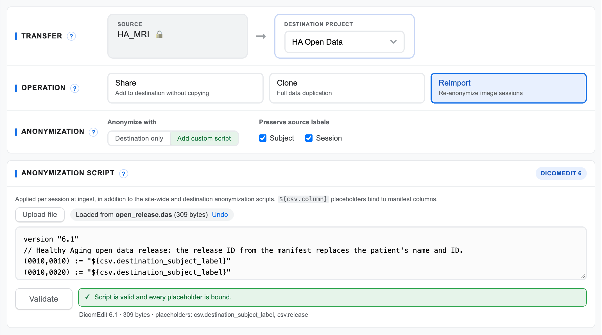

**Preserve source labels** keeps the source's subject and session labels in the destination. Anonymization never
changes XNAT labels, only DICOM tags. For a release you'll usually set new labels in the manifest instead, as below.

Each session's two labels are chosen separately, in this order:

1. The manifest's `destination_subject_label` or `destination_session_label`, if the row has one.
2. The source's label, if its **Preserve source labels** box is ticked.
3. A label XNAT derives from the session's DICOM tags.

So a label in the manifest is used even when its Preserve box is ticked. The Preserve boxes only matter for labels
the manifest leaves blank.

### Choose the sessions with a manifest

A manifest is a CSV file with one row per session. Click **Upload manifest CSV** in the cohort builder and drop the
file on it, or click **choose a file**. This example uses
[`open_release_r1.csv`](quick-start/open_release_r1.csv):

```csv
source_subject_label,source_session_label,destination_subject_label,destination_session_label,release,_notes
HA0003,HA0003_MR01,HAOPEN001,HAOPEN001_MR1,R1,
HA0003,HA0003_MR03,HAOPEN001,HAOPEN001_MR2,R1,
HA0005,HA0005_MR01,HAOPEN002,HAOPEN002_MR1,R1,
HA0005,HA0005_MR03,HAOPEN002,HAOPEN002_MR2,R1,
HA0012,HA0012_MR01,HAOPEN003,HAOPEN003_MR1,R1,follow-up MR still in QC
HA0016,HA0016_MR01,HAOPEN004,HAOPEN004_MR1,R1,
HA0016,HA0016_MR03,HAOPEN004,HAOPEN004_MR2,R1,
```

| Column | Required? | Meaning |
|---|---|---|
| `source_subject_label`, `source_session_label` | Yes | The session in the source project. Leave the session blank to include all of a subject's image sessions. |
| `destination_subject_label`, `destination_session_label` | No | The session's labels in the destination. They take precedence over Preserve source labels. |
| Columns starting with `_` | No | Notes. Batch Transfer ignores them. |
| Any other column | No | A value for the custom script, as `${csv.<column>}`. Here, `release`. |

Batch Transfer matches each row to a session and shows the result, grouped by subject. Expand a row to count its
DICOM files and to see the script with that row's values filled in.

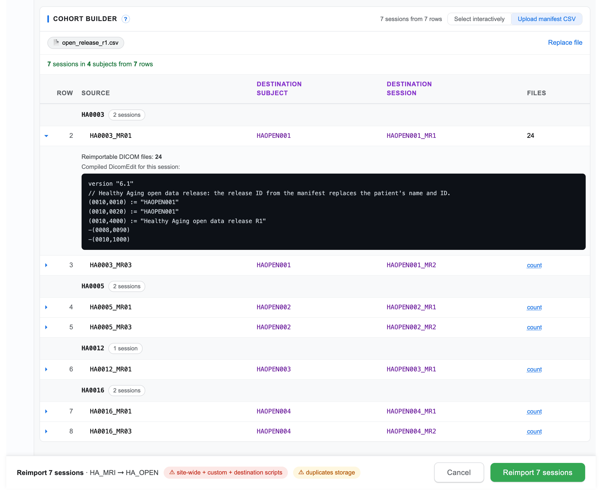

Rows that match nothing are listed and skipped. Some problems block Submit until you fix the file and click
**Replace file**:

- the same session listed twice;
- a value with characters that aren't allowed;
- two sessions that would get the same label;
- two source subjects sent to the same destination subject, which would put two people's sessions in one subject.

Others are highlighted in the Destination columns and counted above the list, but don't block Submit. Hover over a
highlighted cell for the reason:

- a blank destination label, which falls back to Preserve source labels;
- a source subject whose sessions would go to more than one destination subject;
- a session label the destination project already has. That session would fail, or merge into the existing session
  if it holds the same study.

The confirmation lists the warnings again under **Check**.

The chips in this example:

- **site-wide + custom + destination scripts** is red because more than one script will change the data. Hover over
  it for the order. Check that the scripts don't undo each other; here, HA_OPEN's script only adds to what the
  custom script does.
- **duplicates storage** is amber because Reimport writes new copies of the files.

There's no labels chip here, because every row sets both destination labels. If some sessions would keep a source
label, a red chip such as **session label not anonymized** names it, and hovering over it shows how many sessions
keep it.

### Submit

Click **Reimport 7 sessions**. The confirmation lists the manifest, the scripts in the order they'll run, and where
the labels come from. Click **OK**.

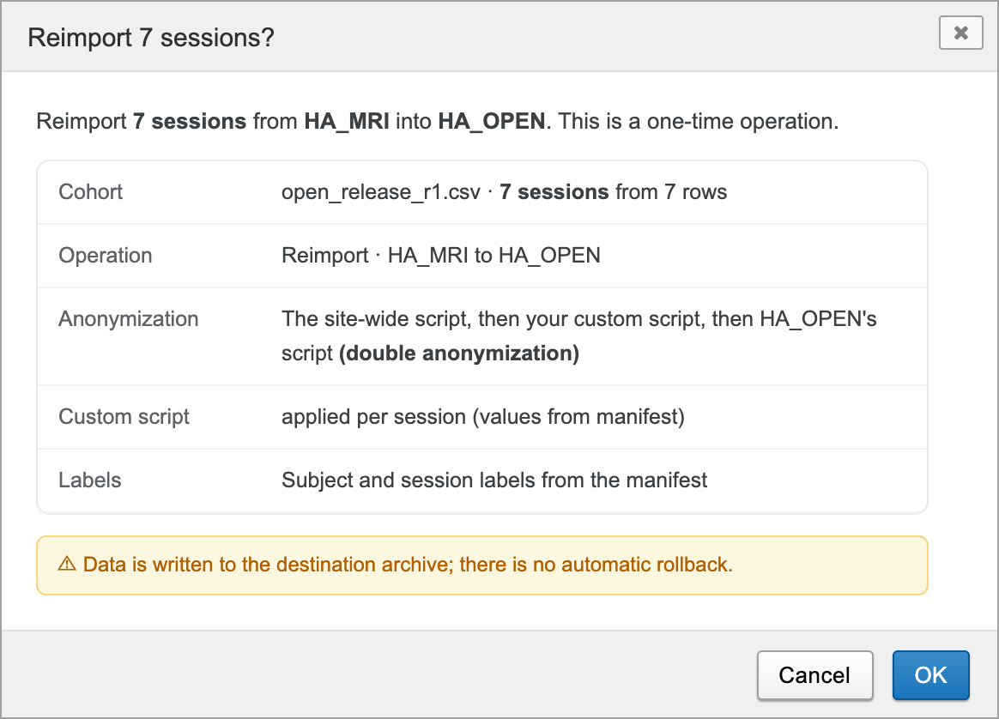

When the transfer finishes, the released sessions carry the release IDs. For example, `HA0003_MR01` in HA_MRI
became `HAOPEN001_MR1` in HA_OPEN:

| DICOM tag | `HA0003_MR01` in HA_MRI | `HAOPEN001_MR1` in HA_OPEN | Changed by |
|---|---|---|---|
| Patient's Name (0010,0010) | `HA0003` | `HAOPEN001` | custom script |
| Patient ID (0010,0020) | `HA0003_MR01` | `HAOPEN001` | custom script |
| Patient's Birth Date (0010,0030) | `19840410` | removed | HA_OPEN's script |
| Patient Comments (0010,4000) | XNAT routing text | `Healthy Aging open data release R1` | custom script |
| Institution Name (0008,0080) | not set | `Healthy Aging Open Data` | HA_OPEN's script |
| Patient Identity Removed (0012,0062) | not set | `YES` | HA_OPEN's script |

## 7. Follow a transfer in History

Transfers run in the background, so you can leave the page once you've submitted one. To check on them, open the
**History** tab. It lists every transfer that involves the project, as source or destination, newest first, 25 to a
page. The list updates while a transfer is running.

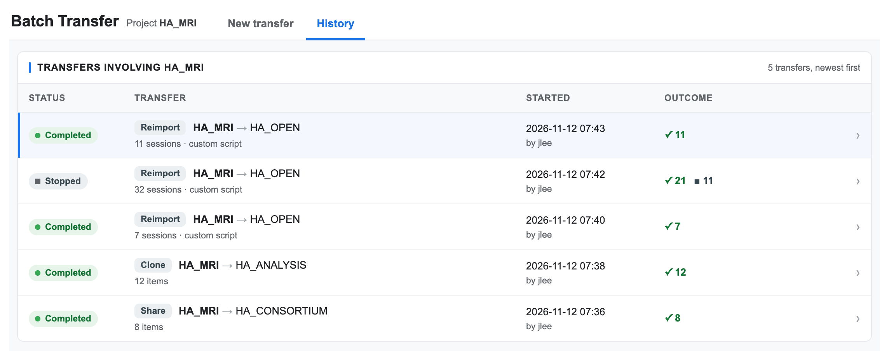

Click a transfer to see its details:

- When it started and finished, who started it, its source, destination and tracking ID, how its sessions were
  anonymized, and where their labels came from.
- The custom script, if one was used.
- Every item, grouped by subject, with its destination and outcome. Failed items come first, with the reason.
  Expand a session to see its manifest values.

**Export results** downloads every item and its outcome as a CSV. **‹ All transfers** goes back to the list.

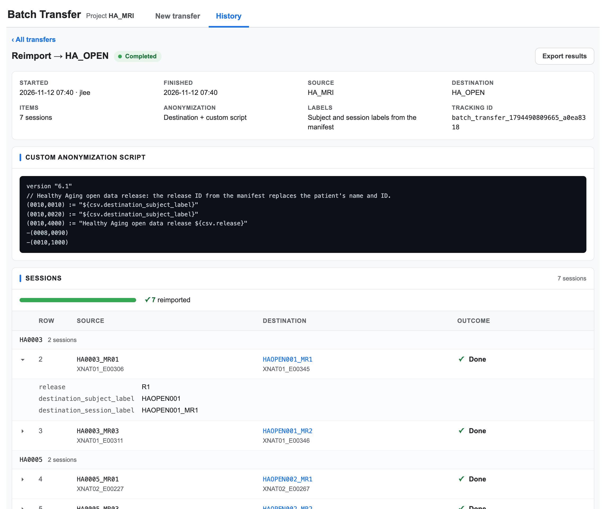

If a destination project is one you can't read, History hides its labels and IDs.

## 8. Stop a transfer and rerun what's left

You can stop a transfer while it's Queued or Running if you started it, or if you're a site administrator. Open the
transfer in History and click **Stop**.

In this example the study started its second release, 32 sessions, then stopped it partway.

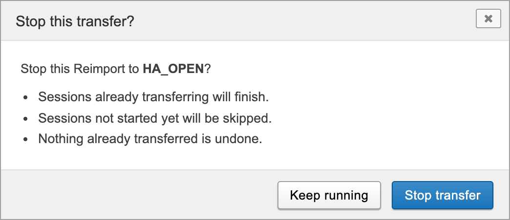

Click **Stop transfer**. The transfer shows Stopping until the sessions already in progress finish, then
**Stopped**. Nothing that already transferred is undone.

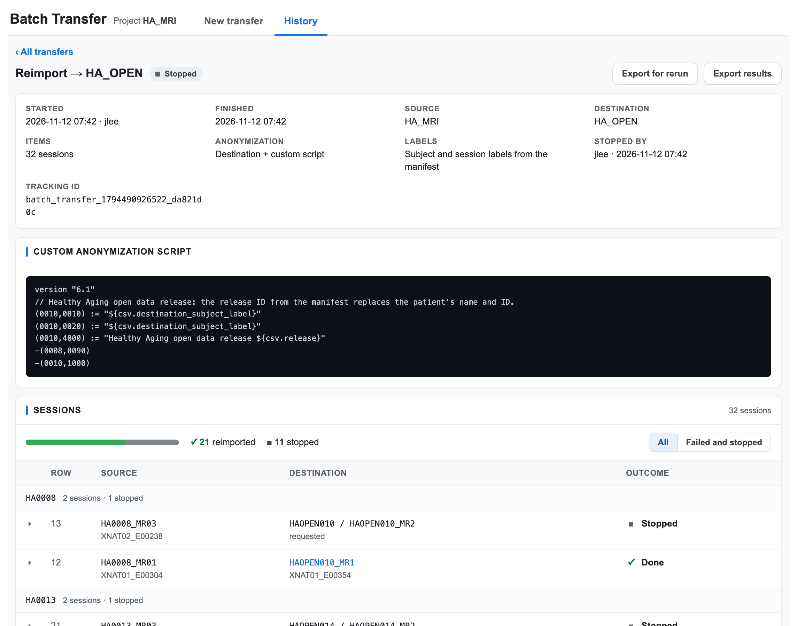

To finish the job later, click **Export for rerun**. It downloads a manifest of the failed and stopped sessions,
with their destination labels and values. On New transfer, choose the same destination and Reimport, add the same
custom script, and upload that manifest unchanged. In this example, the rerun transferred the remaining 11 sessions.

Export for rerun is offered for finished Reimport transfers that have failed or stopped sessions. It isn't offered
if History hides some of the details the manifest would need from you.

## 9. History without a project

**Tools > Batch Transfer History** opens History by itself, with the transfers you started from anywhere, including
from search results. Any logged-in user can open it.

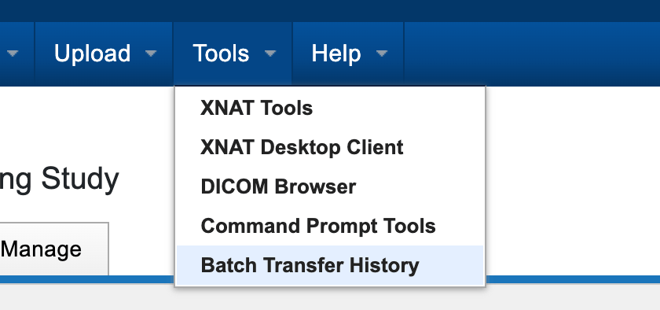

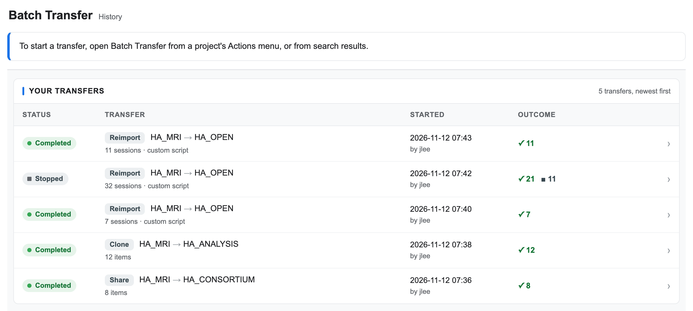

Site administrators also get **Administer > Batch Transfers**. It opens the same page, with a switch between **Your
transfers** and **All transfers** (every transfer on the site).

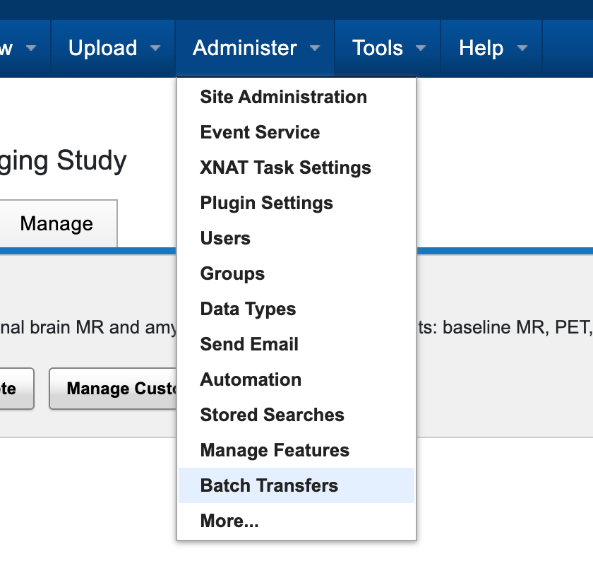

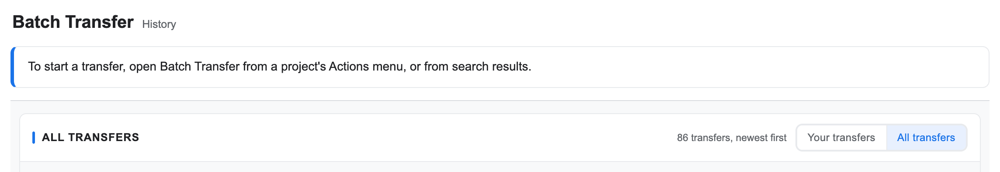

### Links

The address bar always names the History view that's showing, so you can bookmark it or send it to someone:

| Address ends with | Opens |
|---|---|
| `XDATScreen_batch_transfer.vm#history` | Your transfers |
| `XDATScreen_batch_transfer.vm#history/all` | All transfers (site administrators; anyone else sees their own) |
| `XDATScreen_batch_transfer.vm#history/run/<tracking ID>` | One transfer |
| `XDATScreen_batch_transfer.vm?sourceProject=HA_MRI#history` | HA_MRI's History tab |

The full address starts with your site's URL and `/app/template/`. Someone who opens a link still needs permission to
see the transfer.

## 10. Good to know

- **Permissions.** You need to be able to read what you transfer and to add data to the destination. A custom
  anonymization script also needs edit access to the destination.
- **One-time operation.** Clone and Reimport write data into the destination archive. Nothing rolls a transfer back;
  to undo one, delete what it created in the destination.
- **Label clashes.** If the destination already has a different session with the label a reimported session would
  get, that session can fail and its copy stays in the destination's prearchive. Delete that copy, change the
  session's `destination_session_label` in the rerun manifest, and upload it again.
- **Which files Reimport sends.** Reimport sends the files in each scan's DICOM resource. A session whose images are
  stored in a resource with another name, such as the `secondary` resource XNAT uses for Secondary Capture images,
  fails with "No DICOM files found".
- **Manifest limits.** By default a manifest can have up to 5,000 rows, and values used by a script may contain only
  letters, digits, spaces and `^ _ . -`.
- **Script rules.** By default custom scripts are DicomEdit 6.0 to 6.7 or 6.10, up to 256 KB. Commands that are
  unsafe when sessions are reimported in parallel, such as `mapUID` and `newUID`, aren't allowed; use `hashUID` to
  remap UIDs.
- **Adjusting the limits.** A site administrator can change the manifest limits and script rules above on the
  **Anonymization & Cohort Limits** tab in Site Administration: the maximum number of manifest rows, the characters
  allowed in values, the maximum script size, the restricted commands, and the allowed DicomEdit versions.
- **XNAT 1.10.2.1.** Reimports that run at the same time soon after XNAT starts can fail with `Invalid attribute`
  and stay in the prearchive. This is an XNAT bug; Export for rerun transfers them once XNAT has warmed up.

For the REST API behind the screen, see [`rest-api.md`](rest-api.md).
